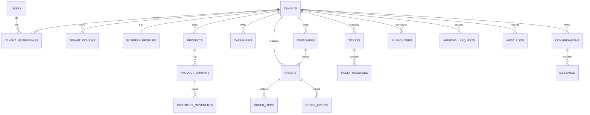
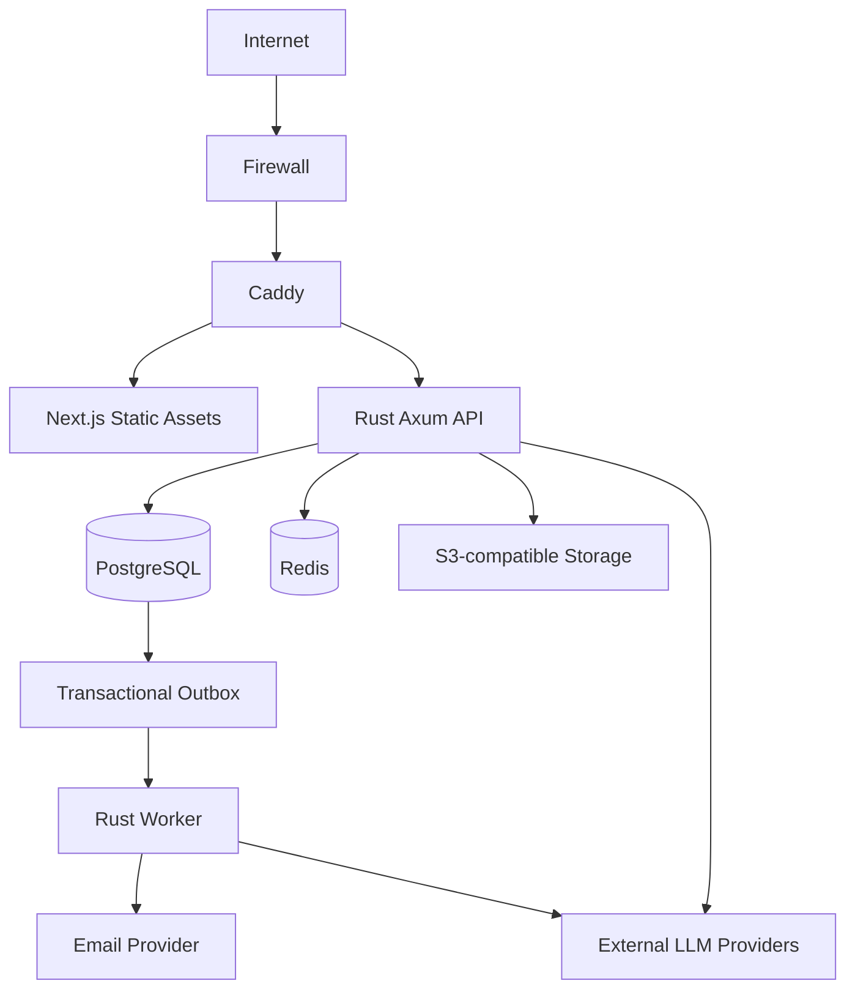

# UMKM Business OS — Product Requirements Document

**Dokumen:** `prd.md`  
**Versi:** 1.0  
**Status:** Baseline untuk product discovery, architecture, dan implementation planning  
**Tanggal:** 11 November 2026  
**Target deployment:** Single VPS, RAM ±8 GB  
**Backend requirement:** Seluruh backend business logic wajib menggunakan Rust

---

## 1. Ringkasan Produk

UMKM Business OS adalah platform SaaS multi-tenant yang membantu UMKM membangun kehadiran digital dan mengelola operasional bisnis dari satu aplikasi.

Setiap UMKM dapat mendaftar, memperoleh subdomain, memilih template website, mengelola katalog dan stok, menerima order, menangani customer melalui ticketing/live chat, serta mengonfigurasi chatbot berbasis LLM OpenAI-compatible.

Platform terdiri dari:
1. **Public platform:** halaman pemasaran dan registrasi SaaS.
2. **Tenant website:** landing page/katalog publik milik masing-masing UMKM.
3. **Tenant dashboard:** pengelolaan bisnis, produk, order, admin, tiket, dan chatbot.
4. **Platform administration:** pengelolaan tenant, paket, penggunaan, domain, dan operasional platform.

### 1.1 Product vision

Memberikan UMKM website dan sistem operasional digital yang mudah digunakan, dapat dikonfigurasi tanpa coding, serta memiliki customer service berbantuan AI.

### 1.2 Prinsip produk

- Multi-tenant sejak awal.
- Mobile-first dan mudah digunakan pengguna non-teknis.
- Security dan tenant isolation sebagai requirement inti.
- AI membantu operasional, tetapi tidak memiliki otoritas transaksi tanpa validasi backend.
- Modular monolith untuk menjaga biaya dan kompleksitas infrastruktur.
- Integrasi eksternal menggunakan adapter agar tidak mengunci platform pada satu vendor.
- Sistem dapat berkembang ke beberapa VPS atau managed services tanpa mengganti domain logic.

### 1.3 Istilah

| Istilah | Definisi |
|---|---|
| Platform | Aplikasi SaaS yang menaungi seluruh tenant |
| Tenant | Satu akun bisnis/UMKM di dalam platform |
| Owner | Pemilik tenant dengan hak administratif tertinggi |
| Member | Pengguna yang diundang ke tenant |
| Customer | Pengunjung/pembeli pada website tenant |
| Tenant domain | Subdomain atau custom domain milik tenant |
| Conversation | Satu rangkaian percakapan customer dengan AI/admin |
| Chat session | Sesi akses/kunjungan yang terkait dengan conversation |
| Ticket | Kasus customer support yang memiliki lifecycle |
| Approval | Keputusan eksplisit oleh user berwenang |

---

## 2. Tujuan, Scope, dan Non-Goals

### 2.1 Tujuan bisnis

- Memungkinkan UMKM membuat website publik tanpa coding.
- Memusatkan katalog, stok, order, dan customer support.
- Menyediakan kolaborasi multi-admin dan approval workflow.
- Menyediakan chatbot dengan provider LLM yang dapat dipilih tenant.
- Membangun fondasi SaaS untuk subscription dan usage-based billing.

### 2.2 Tujuan produk yang dapat diukur

Target awal untuk divalidasi melalui beta:
- Tenant baru dapat menyelesaikan onboarding dan menerbitkan website tanpa bantuan teknis.
- Perubahan katalog dan informasi bisnis dapat dilakukan melalui dashboard.
- Customer dapat mengirim pertanyaan dan membuat order dari website.
- Admin dapat melihat serta menangani conversation dan ticket dalam satu inbox.
- AI dapat menjawab pertanyaan berbasis informasi bisnis tenant tanpa mencampur data tenant lain.
- Seluruh operasi sensitif memiliki authorization dan audit trail.

### 2.3 In-scope

- Registrasi, autentikasi, tenant, membership, RBAC.
- Subdomain otomatis dan domain management.
- Template website dan page builder berbasis schema.
- Profil bisnis, jam operasional, alamat, kontak.
- Kategori, produk, varian, gambar, stok.
- Customer, cart, checkout, order, status order.
- Ticketing, conversation viewer, assignment, multi-admin.
- Approval workflow untuk order dan AI response.
- LLM provider management, OpenAI-compatible API, usage metering.
- Chatbot, handover, knowledge base/RAG dasar.
- Audit log, notifikasi, analytics dasar.
- Subscription/plan foundation.
- Deployment, backup, monitoring, security testing.

### 2.4 Non-goals untuk rilis awal

- Menjalankan model LLM atau embedding model besar secara lokal di VPS 8 GB.
- Marketplace multi-vendor.
- ERP/accounting penuh.
- POS offline dengan sinkronisasi kompleks.
- Fulfillment/logistik tingkat enterprise.
- Native mobile application.
- Arbitrary custom JavaScript/HTML yang dieksekusi pada domain platform.
- Microservices dan Kubernetes sejak awal.
- Integrasi semua payment, marketplace, dan messaging provider pada rilis pertama.

---

## 3. User Roles dan Permission Model

### 3.1 Platform roles

| Role | Tanggung jawab |
|---|---|
| Platform Super Admin | Mengelola tenant, platform configuration, paket, domain, dan operasional |
| Platform Support | Membantu tenant dengan akses terbatas dan tercatat |
| Platform Finance | Mengelola subscription dan billing jika modul diaktifkan |

Platform role terpisah dari tenant role. Platform staff tidak otomatis menjadi member tenant.

### 3.2 Tenant roles

| Role | Hak akses default |
|---|---|
| Owner | Seluruh pengaturan tenant dan pengelolaan anggota |
| Manager | Operasional bisnis, order, produk, tiket, dan approval sesuai policy |
| Admin | Operasional yang diberikan melalui permission |
| Support Agent | Conversation dan ticket yang ditugaskan/diizinkan |
| Catalog Manager | Produk, kategori, dan stok sesuai permission |
| Viewer | Akses baca yang dibatasi |

RBAC harus granular. Role bawaan hanya preset; permission tetap menjadi sumber otorisasi.

### 3.3 Permission examples

- `tenant.read`, `tenant.update`
- `members.read`, `members.invite`, `members.manage`
- `website.read`, `website.edit`, `website.publish`
- `products.read`, `products.create`, `products.update`, `products.archive`
- `inventory.read`, `inventory.adjust`
- `orders.read`, `orders.create`, `orders.approve`, `orders.reject`, `orders.cancel`
- `tickets.read`, `tickets.assign`, `tickets.reply`, `tickets.close`
- `conversations.read`, `conversations.reply`, `conversations.takeover`
- `ai_config.read`, `ai_config.manage`, `ai_provider.manage`
- `approvals.read`, `approvals.decide`
- `analytics.read`, `audit.read`

Semua akses menggunakan deny-by-default dan pemeriksaan object-level authorization.

---

## 4. Functional Requirements

Prioritas: **P0** = wajib untuk rilis awal; **P1** = penting setelah core flow; **P2** = pengembangan lanjutan.

### 4.1 Authentication dan account

| ID | Requirement | Priority |
|---|---|---|
| AUTH-001 | User dapat register menggunakan email dan password | P0 |
| AUTH-002 | Email harus unik secara global, dibandingkan secara case-insensitive | P0 |
| AUTH-003 | Email verification sebelum tenant dipublikasikan | P0 |
| AUTH-004 | Login dan logout | P0 |
| AUTH-005 | Forgot password dan reset menggunakan token sekali pakai | P0 |
| AUTH-006 | Session dapat dicabut per perangkat dan seluruh perangkat | P0 |
| AUTH-007 | Login dan reset password memiliki rate limit | P0 |
| AUTH-008 | User dapat menjadi member beberapa tenant | P0 |
| AUTH-009 | Owner dapat mengundang anggota melalui email | P0 |
| AUTH-010 | Invitation memiliki expiry dan hanya dapat digunakan sekali | P0 |
| AUTH-011 | MFA/TOTP untuk platform Super Admin | P1 |
| AUTH-012 | Owner dapat mewajibkan MFA untuk tenant admin | P1 |

Password disimpan menggunakan Argon2id. Token reset/invitation disimpan dalam bentuk hash, bukan plaintext.

### 4.2 Tenant onboarding dan domain

| ID | Requirement | Priority |
|---|---|---|
| TEN-001 | Setelah registrasi bisnis, sistem membuat tenant | P0 |
| TEN-002 | Sistem membuat membership Owner | P0 |
| TEN-003 | Sistem membuat business profile dan konfigurasi default | P0 |
| TEN-004 | Sistem menghasilkan subdomain otomatis | P0 |
| TEN-005 | Slug/subdomain harus unik dan divalidasi | P0 |
| TEN-006 | Reserved subdomain tidak dapat digunakan | P0 |
| TEN-007 | Tenant dapat mengganti subdomain melalui proses validasi | P1 |
| TEN-008 | Custom domain dapat didaftarkan dan diverifikasi | P1 |
| TEN-009 | Domain suspended/disabled tidak boleh melayani tenant website | P0 |

Contoh routing:
- `app.platform.id` — dashboard.
- `api.platform.id` — API.
- `tokosaya.platform.id` — website tenant.
- `tokosaya.com` — custom domain tenant setelah verifikasi.

Validasi hostname harus dilakukan terhadap tabel domain yang terdaftar. Jangan menerima `tenant_id` dari browser sebagai bukti tenant identity.

### 4.3 Website builder

Fitur:
- Template catalog dan preview.
- Template versioning.
- Page editor berbasis section/component.
- Pengaturan logo, warna, typography preset, teks, gambar, CTA.
- Pengurutan dan enable/disable section.
- Mobile/desktop preview.
- Draft, preview, publish, dan rollback.
- Halaman publik responsive.

Komponen awal:
- Header/navigation.
- Hero/banner.
- About.
- Product/category grid.
- Promotion.
- Gallery.
- Testimonials.
- Business hours.
- Location/address.
- Contact/social links.
- Footer.

Page content disimpan sebagai JSON schema tervalidasi. Arbitrary HTML/JavaScript tidak boleh dieksekusi pada tenant website. Setiap publish membuat immutable page version. Draft tidak boleh tampil di publik.

Contoh schema:

```json
{
  "schema_version": 1,
  "template": "modern_store",
  "theme": {
    "primary": "#2563EB",
    "font": "Inter"
  },
  "sections": [
    {
      "id": "hero-001",
      "type": "hero",
      "enabled": true,
      "data": {
        "title": "Selamat Datang",
        "subtitle": "Produk pilihan untuk Anda"
      }
    },
    {
      "id": "products-001",
      "type": "product_grid",
      "enabled": true,
      "data": {
        "limit": 8
      }
    }
  ]
}
```

### 4.4 Business profile

- Nama dan deskripsi bisnis.
- Logo dan cover image.
- Nomor telepon, email, WhatsApp, social links.
- Satu atau lebih alamat.
- Koordinat lokasi opsional.
- Jam operasional per hari.
- Hari libur/exception hours.
- Status buka/tutup dapat dihitung dari timezone tenant.
- Informasi pickup/delivery jika tersedia.

### 4.5 Product catalog dan inventory

Produk:
- Create, update, archive, dan list.
- Kategori dan subkategori.
- SKU unik per tenant sesuai policy.
- Deskripsi, harga, harga promo.
- Varian dan opsi.
- Foto produk.
- Status draft/active/archived.
- Availability.

Inventory:
- Stock in/out/adjustment.
- Minimum stock threshold.
- Movement history.
- Reservation untuk checkout.
- Low-stock event.
- Policy stok negatif dapat dinonaktifkan secara default.

Setiap stock mutation wajib menyimpan actor, tenant, item/variant, delta, reason, reference, dan timestamp. Perubahan stok harus transactional dan aman dari race condition/overselling.

### 4.6 Customer dan CRM

- Guest customer dan registered customer.
- Profil nama, email, telepon.
- Alamat customer.
- Order history.
- Conversation/ticket history.
- Tags dan internal notes.
- Pencarian customer.
- Account linking hanya setelah verifikasi.
- Data export/deletion mengikuti retention policy dan ketentuan hukum yang berlaku.

### 4.7 Cart, checkout, dan order

Customer flow:
1. Browse produk.
2. Tambahkan item ke cart.
3. Ubah quantity.
4. Isi data customer.
5. Pilih pickup/delivery jika tersedia.
6. Konfirmasi order.
7. Melihat status order.

Server wajib menghitung ulang harga, promo, ongkir jika ada, dan total. Client tidak dipercaya sebagai sumber harga atau stock availability.

Order menyimpan snapshot nama produk, SKU, varian, harga, dan quantity agar perubahan katalog tidak mengubah transaksi lama.

Status yang disarankan:

```text
PENDING
AWAITING_PAYMENT
PAID
APPROVAL_PENDING
APPROVED
PROCESSING
READY_FOR_PICKUP
SHIPPED
COMPLETED
REJECTED
CANCELLED
EXPIRED
REFUNDED
```

Tidak semua status wajib digunakan untuk setiap payment mode. COD/manual payment dapat memiliki transisi berbeda. State transition harus eksplisit dan divalidasi.

Order approval:
- Manager/approver dapat approve/reject sesuai permission.
- Rejection memerlukan alasan.
- Actor dan timestamp tercatat.
- Pemohon tidak boleh menyetujui permintaannya sendiri jika separation-of-duties policy diaktifkan.
- Customer menerima notifikasi perubahan status.

Integrity:
- Idempotency key pada checkout.
- Inventory reservation dengan expiry.
- Payment webhook signature verification.
- Deduplication external event.
- Immutable order item snapshot.
- Refund audit trail.

Payment gateway tertentu belum dipilih; integrasi dibuat melalui adapter.

### 4.8 Ticketing dan customer support

Ticket dapat berasal dari:
- Chatbot/live chat.
- Order issue.
- Manual admin creation.
- System event.

Ticket fields:
- ID, tenant, customer, conversation, order.
- Subject, description, priority, status.
- Assignee, created/updated/resolved timestamps.

Lifecycle:

```text
OPEN
ASSIGNED
IN_PROGRESS
WAITING_CUSTOMER
WAITING_INTERNAL
RESOLVED
CLOSED
```

Kemampuan:
- Assign/reassign admin.
- Priority dan tags.
- Public reply dan internal note.
- Attachment.
- Search/filter.
- History.
- SLA timestamp/target.
- Reopen sesuai policy.

Ticket dan conversation adalah entity berbeda. Satu conversation dapat menghasilkan satu atau beberapa ticket sesuai aturan produk.

### 4.9 Multi-admin dan approval workflow

Approval engine reusable untuk:
- Order.
- Refund.
- Stock adjustment.
- Price change.
- AI response.
- Business configuration.

Mendukung:
- Single approver.
- Sequential multi-step approval.
- Rejection reason.
- Timeout.
- Delegation policy.
- Event history.

Approval harus memeriksa permission, approver assignment, entity state, dan tenant context. Mengubah status entity secara langsung tidak boleh melewati approval.

### 4.10 AI chatbot dan provider management

Setiap tenant dapat mengatur:
- Provider.
- Base URL.
- API key.
- Model.
- Temperature.
- Max output tokens.
- Timeout.
- Fallback provider/model.
- System prompt.
- Welcome/fallback message.
- Auto-reply mode.
- Human handover policy.
- Allowed/restricted topics.
- Tool permissions.
- Operating schedule.
- Token/cost budget.

Provider target:
- OpenAI.
- OpenRouter.
- Groq.
- Together AI.
- vLLM.
- Ollama (hanya melalui trusted network/provider configuration).
- Custom OpenAI-compatible endpoint.

Jangan mengasumsikan seluruh provider mendukung semua fitur. Gunakan capability registry untuk chat, streaming, tool calling, usage reporting, dan fitur lain.

API key:
- Dienkripsi at rest.
- Tidak pernah dikembalikan ke frontend.
- UI hanya menampilkan masked value.
- Tidak boleh masuk log.
- Mendukung rotasi dan disable.

Mode chatbot:
| Mode | Perilaku |
|---|---|
| Auto | AI dapat mengirim jawaban sesuai policy |
| Assisted | AI membuat draft, admin mengirim |
| Hybrid | AI menangani pertanyaan tertentu dan eskalasi sisanya |
| Human Only | AI tidak mengirim jawaban |

Default yang disarankan: Hybrid.

### 4.11 AI orchestration dan tools

Pipeline:

```text
Customer Message
  -> Conversation Resolver
  -> Tenant AI Configuration
  -> Input Validation / Guardrails
  -> Context Builder
  -> Tenant-scoped Retrieval
  -> LLM Provider Router
  -> Response Validation
  -> Auto Reply / Admin Approval / Human Handover
```

Tools awal:
| Tool | Permission |
|---|---|
| `search_products` | Read |
| `get_product_detail` | Read |
| `check_stock` | Read |
| `get_business_hours` | Read |
| `get_business_location` | Read |
| `search_faq` | Read |
| `get_customer_orders` | Scoped read |
| `get_order_status` | Scoped read |
| `create_order_draft` | Restricted write |
| `request_human_support` | Restricted write |

LLM tidak boleh memiliki akses SQL langsung, unrestricted HTTP, payment credentials, user management, atau administrative APIs. Setiap tool call divalidasi dan diotorisasi oleh backend. AI output dianggap untrusted input.

### 4.12 Chat ID dan Conversation Viewer

Setiap conversation, session, dan message memiliki UUID terpisah.

Sender types:
- `CUSTOMER`
- `AI`
- `ADMIN`
- `SYSTEM`

Admin viewer menampilkan:
- Conversation timeline.
- Customer context.
- Provider/model.
- Token usage dan latency.
- Tool call summary.
- Assignment dan handover history.
- Conversation status.
- Approval state.

Sensitive data harus dimasking sesuai permission.

Analytics:
- Total conversation.
- AI-resolved conversation.
- Human-resolved conversation.
- Average response/resolution time.
- Handover rate.
- Fallback rate.
- Token consumption.
- Provider error rate.

### 4.13 Notification

Channel awal:
- In-app.
- Email.
- SSE/WebSocket untuk realtime.

Event:
- New order.
- Order approved/rejected.
- New ticket.
- Ticket assigned.
- Customer reply.
- Approval request.
- Low stock.
- AI handover.
- Subscription status.

Gunakan transactional outbox agar event tidak hilang ketika aplikasi gagal setelah database commit. Delivery harus idempotent dan memiliki retry/backoff.

### 4.14 Analytics dan platform administration

Tenant analytics:
- Revenue/order volume.
- Average order value.
- Top products.
- Stock alert.
- Customer growth.
- Cancellation rate.
- Ticket volume dan resolution time.
- AI resolution/handover.
- Usage AI.

Platform analytics:
- Tenant active/suspended.
- Subscription distribution.
- API usage.
- AI usage.
- Provider errors.
- Infrastructure health.

Semua analytics tenant harus scoped. Platform-level aggregation hanya dapat diakses platform role yang berwenang.

### 4.15 Subscription dan monetization

Sediakan plan/limit foundation meskipun payment billing belum masuk MVP.

Contoh limit configurable:
- Jumlah admin.
- Jumlah produk.
- Custom domain.
- AI token/cost budget.
- Ticket/conversation volume.
- Storage.
- Feature flags.

Jangan hardcode plan limit di source code. AI usage harus menghitung token dan/atau estimasi biaya, bukan hanya jumlah request.

---

## 5. Database Architecture

### 5.1 Pilihan arsitektur

Gunakan **PostgreSQL shared database + shared schema + tenant_id + Row-Level Security (RLS)** untuk tahap awal.

Alasan:
- Lebih hemat resource dibanding database per tenant.
- Operasional dan backup lebih sederhana.
- Cocok untuk satu VPS.
- Dapat dikembangkan ke database terpisah untuk tenant tertentu jika kebutuhan isolation/compliance meningkat.

### 5.2 Database conventions

- UUID primary keys.
- `tenant_id` pada seluruh tenant-owned records.
- `TIMESTAMPTZ` untuk timestamp.
- `NUMERIC` untuk nilai uang, bukan floating point.
- Foreign keys dan unique constraints.
- Composite foreign keys untuk mencegah relasi lintas tenant.
- Index pada foreign key dan kolom filter/sort utama.
- Versioned migrations.
- Soft delete hanya jika ada kebutuhan recovery/audit.
- Explicit retention dan purge policy.

### 5.3 Entity Relationship Overview



### 5.4 Table inventory

#### Identity dan tenant

| Table | Kolom penting |
|---|---|
| `users` | id, email, password_hash, status, email_verified_at |
| `tenants` | id, name, slug, status, created_at |
| `tenant_memberships` | id, tenant_id, user_id, role_id, status |
| `roles` | id, tenant_id nullable, name, is_system |
| `permissions` | id, permission_key |
| `role_permissions` | role_id, permission_id |
| `tenant_domains` | id, tenant_id, hostname, type, status |
| `invitations` | id, tenant_id, email, role_id, token_hash, expires_at |
| `user_sessions` | id, user_id, token_hash, expires_at, revoked_at |
| `mfa_credentials` | id, user_id, encrypted_secret |

#### Business dan website

| Table | Kolom penting |
|---|---|
| `business_profiles` | tenant_id, name, description, logo_key, phone |
| `business_addresses` | id, tenant_id, address, latitude, longitude |
| `business_hours` | id, tenant_id, day_of_week, open_time, close_time |
| `business_hour_exceptions` | id, tenant_id, date, is_closed, hours_json |
| `website_templates` | id, name, category, version |
| `tenant_websites` | id, tenant_id, template_id, status |
| `website_pages` | id, tenant_id, website_id, slug |
| `website_page_versions` | id, page_id, version, content_json |

#### Commerce dan inventory

| Table | Kolom penting |
|---|---|
| `categories` | id, tenant_id, name, parent_id |
| `products` | id, tenant_id, category_id, name, sku, status |
| `product_variants` | id, tenant_id, product_id, sku, price |
| `product_images` | id, tenant_id, product_id, storage_key |
| `inventory` | id, tenant_id, variant_id, quantity |
| `inventory_movements` | id, tenant_id, variant_id, delta, reason |
| `inventory_reservations` | id, tenant_id, variant_id, quantity, expires_at |
| `customers` | id, tenant_id, name, email, phone |
| `customer_addresses` | id, tenant_id, customer_id, address |
| `carts` | id, tenant_id, customer_id, status |
| `cart_items` | id, tenant_id, cart_id, variant_id, quantity |
| `orders` | id, tenant_id, customer_id, order_number, status, total |
| `order_items` | id, tenant_id, order_id, product_snapshot, quantity, price |
| `order_events` | id, tenant_id, order_id, event_type, actor_id |
| `payments` | id, tenant_id, order_id, provider, status, amount |
| `refunds` | id, tenant_id, payment_id, amount, status |

#### Ticketing dan approval

| Table | Kolom penting |
|---|---|
| `tickets` | id, tenant_id, customer_id, conversation_id, order_id, status |
| `ticket_messages` | id, tenant_id, ticket_id, sender_type, body |
| `ticket_assignments` | id, tenant_id, ticket_id, user_id |
| `ticket_tags` | id, tenant_id, name |
| `ticket_tag_assignments` | ticket_id, tag_id |
| `approval_requests` | id, tenant_id, entity_type, entity_id, status |
| `approval_steps` | id, tenant_id, approval_id, approver_id, status |
| `approval_events` | id, tenant_id, approval_id, actor_id, action |

#### AI dan conversation

| Table | Kolom penting |
|---|---|
| `ai_providers` | id, tenant_id, provider_type, base_url, status |
| `ai_provider_secrets` | provider_id, encrypted_api_key |
| `chatbot_configs` | id, tenant_id, system_prompt, settings_json |
| `chatbot_tools` | id, tenant_id, tool_name, enabled |
| `knowledge_bases` | id, tenant_id, name, status |
| `knowledge_documents` | id, tenant_id, knowledge_base_id, source |
| `knowledge_chunks` | id, tenant_id, document_id, content, embedding |
| `conversations` | id, tenant_id, customer_id, status, assigned_admin_id |
| `chat_sessions` | id, tenant_id, conversation_id, session_key |
| `messages` | id, tenant_id, conversation_id, sender_type, content |
| `ai_runs` | id, tenant_id, conversation_id, provider_id, model |
| `ai_tool_calls` | id, tenant_id, ai_run_id, tool_name, result_status |
| `ai_usage_logs` | id, tenant_id, provider_id, input_tokens, output_tokens |

#### Platform dan infrastructure

| Table | Kolom penting |
|---|---|
| `plans` | id, name, limits_json |
| `subscriptions` | id, tenant_id, plan_id, status |
| `usage_records` | id, tenant_id, metric, quantity |
| `notifications` | id, tenant_id, user_id, status |
| `notification_outbox` | id, tenant_id, event_type, payload, status |
| `audit_logs` | id, tenant_id nullable, actor_id, action, resource_type |
| `idempotency_keys` | id, tenant_id, key, response_hash |
| `webhook_events` | id, tenant_id nullable, provider, external_event_id |
| `background_jobs` | id, tenant_id nullable, job_type, status |

Table inventory adalah baseline konseptual. Sebelum migration final, setiap tabel harus memiliki tipe data, nullability, constraints, index, retention, dan RLS policy yang ditentukan.

### 5.5 Global vs tenant-owned data

Global:
- `users`
- `permissions`
- `website_templates`
- `plans`
- platform settings
- platform audit logs

Tenant-owned:
- products, orders, customers, conversations, tickets, messages, AI providers, business profiles, inventory movements.

Association table harus menjaga tenant boundary ketika menghubungkan data tenant.

### 5.6 Constraints minimum

```sql
CREATE UNIQUE INDEX uq_users_email
ON users (LOWER(email));

CREATE UNIQUE INDEX uq_membership_user_tenant
ON tenant_memberships (tenant_id, user_id);

CREATE UNIQUE INDEX uq_tenant_domains_hostname
ON tenant_domains (LOWER(hostname));

CREATE UNIQUE INDEX uq_product_sku
ON products (tenant_id, sku)
WHERE deleted_at IS NULL AND sku IS NOT NULL;

CREATE UNIQUE INDEX uq_order_number
ON orders (tenant_id, order_number);

CREATE UNIQUE INDEX uq_webhook_event
ON webhook_events (provider, external_event_id);
```

Composite foreign key harus dipakai pada hubungan tenant-owned. Contoh:

```sql
ALTER TABLE orders
ADD CONSTRAINT uq_orders_tenant_id
UNIQUE (tenant_id, id);

ALTER TABLE order_items
ADD CONSTRAINT fk_order_items_tenant
FOREIGN KEY (tenant_id, order_id)
REFERENCES orders (tenant_id, id);
```

### 5.7 RLS strategy

Aktifkan dan FORCE RLS pada tenant-owned tables. Role aplikasi bukan superuser dan tidak memiliki `BYPASSRLS`.

Contoh:

```sql
ALTER TABLE products ENABLE ROW LEVEL SECURITY;
ALTER TABLE products FORCE ROW LEVEL SECURITY;

CREATE POLICY tenant_products_policy
ON products
USING (
  tenant_id =
  NULLIF(current_setting('app.tenant_id', true), '')::uuid
)
WITH CHECK (
  tenant_id =
  NULLIF(current_setting('app.tenant_id', true), '')::uuid
);
```

Set tenant context di dalam setiap transaction:

```sql
BEGIN;
SELECT set_config('app.tenant_id', $1, true);
SELECT * FROM products;
COMMIT;
```

Setting transaction-local (`true`) mengurangi risiko context tertinggal pada pooled connection. Semua repository query tetap harus menyertakan tenant scope sebagai defense-in-depth. RLS bukan pengganti application authorization.

Tenant context harus berasal dari hostname/session/membership yang sudah diverifikasi, bukan dari input bebas client. Integration tests wajib membuktikan connection reuse tidak menyebabkan tenant context leakage.

---

## 6. Security Requirements

Security merupakan release gate, bukan pekerjaan pasca-MVP. Gunakan OWASP ASVS sebagai verification baseline dan threat modeling untuk fitur tenant, file upload, AI, dan external integrations.

### 6.1 Authentication

- Argon2id untuk password hashing.
- Salt unik dan parameter hashing yang dapat ditingkatkan.
- Rate limit login, registration, password reset, dan verification.
- Secure, HttpOnly, SameSite cookies jika menggunakan cookie session.
- CSRF protection untuk state-changing cookie-authenticated requests.
- Session rotation setelah login/privilege change.
- Session revocation.
- Reset token hash, one-time, short expiry.
- MFA untuk platform Super Admin.
- Jangan menyimpan password atau token plaintext.

### 6.2 Authorization

- Deny-by-default.
- RBAC granular.
- Tenant membership validation.
- Object-level authorization.
- Ownership validation.
- Separation-of-duties untuk approval bila diaktifkan.
- Admin tidak boleh mengakses data di luar permission.
- AI tool call melewati permission check yang sama.

### 6.3 Tenant isolation

Isolation mencakup:
- PostgreSQL dan RLS.
- Redis/cache.
- Object storage.
- Background jobs.
- SSE/WebSocket.
- Search/RAG retrieval.
- AI context dan conversation.
- Analytics.
- Exports dan downloads.

Cache key harus memasukkan tenant namespace, misalnya:

```text
tenant:{tenant_id}:products:{product_id}
tenant:{tenant_id}:conversation:{conversation_id}
tenant:{tenant_id}:inventory:{variant_id}
```

Object storage key dan signed URL harus scoped, memiliki expiry, dan tidak mengungkap path internal.

### 6.4 API security

- TLS wajib.
- CORS allowlist.
- Request body dan upload size limit.
- Strict schema validation.
- Timeout dan concurrency limit.
- Rate limiting per IP, user, tenant, dan endpoint sesuai kebutuhan.
- API versioning.
- Idempotency pada operasi transaksi.
- Pagination limit.
- SQL injection prevention melalui parameterized query.
- Security headers.
- Error response tidak mengungkap stack trace, SQL, secret, atau internal topology.
- SSRF prevention untuk custom provider URL.

### 6.5 SSRF controls untuk custom LLM endpoint

Base URL yang dimasukkan tenant adalah input berisiko tinggi.

Wajib:
1. Validasi scheme dan hostname.
2. HTTPS secara default; pengecualian hanya untuk trusted internal provider yang disetujui platform.
3. Tolak localhost, private IPv4/IPv6, link-local, multicast, dan metadata endpoint.
4. Validasi DNS resolution dan semua resolved IP.
5. Cegah DNS rebinding sejauh dapat diterapkan pada HTTP client/network layer.
6. Disable redirects atau validasi ulang setiap redirect target.
7. Batasi timeout, response size, dan concurrency.
8. Jangan mengirim credential ke host yang tidak lolos validasi.
9. Trusted internal Ollama/vLLM harus didaftarkan oleh platform operator, bukan membuka akses jaringan internal bebas kepada tenant.

### 6.6 AI security

Ancaman:
- Direct/indirect prompt injection.
- Knowledge-base poisoning.
- Cross-tenant context leakage.
- Data exfiltration.
- Tool abuse.
- Unauthorized order/refund.
- API key leakage.
- Excessive token consumption.
- Unrestricted outbound request.

Mitigasi:
- Tenant-scoped retrieval.
- Tool allowlist dan permission.
- Validasi parameter tool di backend.
- AI tidak mendapat SQL/database credentials.
- Approval untuk tindakan sensitif.
- Output LLM dianggap untrusted.
- Context source validation.
- Token/cost quota.
- Provider timeout dan circuit breaker.
- Redaction pada log.
- Test prompt injection dan data isolation.

### 6.7 Secrets management

Secrets meliputi database, Redis, session, LLM, email, payment, storage, dan encryption keys.

- Encrypt sensitive provider credentials at rest.
- Gunakan envelope encryption bila memungkinkan.
- Master key disimpan di environment secret/secret manager terpisah dari database.
- Key versioning dan rotation.
- Masked display.
- Tidak pernah dikirim kembali ke frontend.
- Tidak masuk logs, traces, analytics, atau error payload.
- Production secrets tidak disimpan di repository atau image.

### 6.8 File upload

- Validasi MIME berdasarkan isi file, bukan ekstensi saja.
- Limit size dan dimensi gambar.
- Random storage key.
- Path traversal protection.
- Reject executable content.
- Strip metadata gambar bila relevan.
- Malware scanning bila tersedia.
- Private storage untuk attachment.
- Signed URL short expiry.
- Tenant-scoped access.
- Content-Disposition dan content-type yang aman.

### 6.9 Audit logging

Event minimum:
- Login/logout dan security events.
- User invitation/role change.
- Business/domain/website changes.
- Product dan stock changes.
- Order create/approve/reject/cancel.
- Payment/refund events.
- Ticket assignment/closure.
- AI provider/config/key changes.
- Chat handover/approval.
- Platform admin access.

Audit record mencakup actor, tenant, action, resource, timestamp, request ID, dan before/after summary jika sesuai. Jangan merekam password, API key, full payment credentials, atau message body sensitif secara default. Audit log bersifat append-only dari perspektif aplikasi.

### 6.10 Backup dan disaster recovery

Target awal:
| Parameter | Target |
|---|---|
| Full backup | Daily |
| WAL archiving | Continuous/frequent |
| Retention | 7 daily + 4 weekly |
| RPO | 15 menit (target) |
| RTO | 4 jam (target) |
| Encryption | Wajib |
| Restore drill | Bulanan |

Backup wajib berada di luar VPS. Target RPO/RTO harus divalidasi dengan backup tooling, bandwidth, ukuran database, dan latihan restore; bukan jaminan otomatis.

---

## 7. Backend Architecture — Rust Mandatory

### 7.1 Recommended stack

| Area | Technology |
|---|---|
| Language | Rust stable |
| Async runtime | Tokio |
| HTTP framework | Axum |
| Middleware | Tower / tower-http |
| Database access | SQLx |
| Serialization | Serde |
| Validation | garde atau validator yang dipilih setelah dependency review |
| Password hashing | argon2 crate |
| HTTP client | reqwest |
| Realtime | Axum WebSocket + SSE |
| Logging/tracing | tracing |
| OpenAPI | utoipa |
| Error handling | thiserror + anyhow pada boundary yang tepat |
| Metrics | Prometheus-compatible metrics |
| Migrations | SQLx migrations |
| Testing | cargo test + integration/security tests |

Dependency harus dievaluasi status maintenance, advisories, license, dan compatibility sebelum dipilih. Pin dependency dan commit `Cargo.lock`.

### 7.2 Architecture pattern

Gunakan modular monolith dan pemisahan:

```text
HTTP Handler
    -> Application Use Case
        -> Domain Service
            -> Repository / Port
                -> Infrastructure Adapter
```

HTTP handler tidak boleh berisi business logic utama. Domain logic tidak boleh bergantung pada Axum atau database implementation.

### 7.3 Suggested repository structure

```text
umkm-business-os/
├── apps/
│   ├── api/
│   │   └── src/
│   │       ├── main.rs
│   │       ├── bootstrap.rs
│   │       ├── router.rs
│   │       └── middleware/
│   └── worker/
│       └── src/
│           ├── main.rs
│           ├── scheduler.rs
│           └── jobs/
├── crates/
│   ├── domain/
│   ├── application/
│   ├── infrastructure/
│   ├── database/
│   ├── auth/
│   ├── tenant/
│   ├── business/
│   ├── website/
│   ├── catalog/
│   ├── inventory/
│   ├── commerce/
│   ├── crm/
│   ├── ticketing/
│   ├── approvals/
│   ├── ai_orchestrator/
│   ├── notifications/
│   ├── analytics/
│   ├── billing/
│   ├── audit/
│   └── shared/
├── migrations/
├── config/
├── docs/
│   ├── architecture/
│   ├── api/
│   ├── security/
│   └── decisions/
├── tests/
│   ├── integration/
│   ├── security/
│   ├── tenancy/
│   └── workflows/
├── Cargo.toml
├── Cargo.lock
└── README.md
```

Struktur ini adalah starting point. Jangan membuat crate terlalu kecil tanpa boundary yang benar-benar bermanfaat.

### 7.4 API conventions

Prefix: `/api/v1`.

Endpoint domains:
| Domain | Example endpoints |
|---|---|
| Auth | `/auth/register`, `/auth/login`, `/auth/logout` |
| Tenant | `/tenants`, `/tenants/{id}` |
| Domains | `/domains`, `/domains/verify` |
| Business | `/business/profile`, `/business/hours` |
| Website | `/website/templates`, `/website/pages`, `/website/publish` |
| Products | `/products`, `/categories`, `/variants` |
| Inventory | `/inventory`, `/inventory/movements` |
| Customers | `/customers`, `/customers/{id}` |
| Cart | `/cart`, `/cart/items` |
| Orders | `/orders`, `/orders/{id}/approve` |
| Payments | `/payments`, `/payments/webhooks` |
| Tickets | `/tickets`, `/tickets/{id}/messages` |
| Approvals | `/approvals`, `/approvals/{id}/approve` |
| AI | `/ai/providers`, `/ai/config`, `/ai/test` |
| Conversations | `/conversations`, `/conversations/{id}/messages` |
| Chatbot | `/chatbot/message`, `/chatbot/handover` |
| Analytics | `/analytics/business`, `/analytics/support` |
| Team | `/team/members`, `/team/invitations` |
| Billing | `/billing/subscription`, `/billing/usage` |

Public customer API dan tenant admin API harus memiliki authorization policy berbeda.

Success response:

```json
{
  "success": true,
  "data": {"id": "uuid"},
  "meta": {"request_id": "req-uuid"}
}
```

Error response:

```json
{
  "success": false,
  "error": {
    "code": "RESOURCE_NOT_FOUND",
    "message": "Resource not found",
    "details": null
  },
  "meta": {"request_id": "req-uuid"}
}
```

Gunakan cursor pagination untuk messages, conversations, orders, audit logs, dan inventory movements. Offset pagination dapat digunakan untuk katalog kecil.

### 7.5 Realtime

- SSE untuk streaming chatbot dan one-way updates.
- WebSocket untuk bidirectional live chat.
- HTTP untuk CRUD dan transaksi.
- Authentication dan tenant authorization harus diperiksa saat koneksi dan setiap subscription/resource access.
- Connection count dan message size harus dibatasi.

---

## 8. AI Orchestration dan RAG

### 8.1 Provider adapter

Unified adapter harus menormalkan:
- Chat completion request/response.
- Streaming chunks.
- Tool/function calling.
- Usage extraction.
- Provider errors.
- Timeout/cancellation.
- Model identification.

Capability registry contoh:

```json
{
  "provider": "custom",
  "capabilities": {
    "chat": true,
    "streaming": true,
    "tool_calling": false,
    "usage_reporting": true
  }
}
```

### 8.2 RAG pipeline

```text
Knowledge Source
 -> Document Validation
 -> Text Extraction
 -> Chunking
 -> External Embedding Provider
 -> PostgreSQL + pgvector
 -> Tenant-scoped Retrieval
 -> Context Assembly
 -> LLM
```

Untuk VPS 8 GB:
- Jangan menjalankan embedding inference lokal pada tahap awal.
- Embedding dapat menggunakan provider eksternal.
- Batch ingestion.
- Batasi chunk count dan context size.
- Retrieval harus tenant-scoped.
- Cache hanya jika tenant key dan invalidation aman.
- Knowledge source harus dapat dihapus dan diindeks ulang.

RAG tidak menjamin kebenaran jawaban. Tampilkan fallback/handover ketika informasi tidak tersedia atau confidence policy gagal.

---

## 9. Infrastructure dan Deployment — VPS 8 GB RAM

### 9.1 Topology



### 9.2 Frontend decision

Rekomendasi untuk VPS 8 GB adalah Next.js static export bila kebutuhan halaman dapat dipenuhi secara statis dan client-side API calls.

- Caddy melayani static assets.
- Tidak ada Next.js Node server di production.
- API dan seluruh business logic tetap berada di Rust.
- Jika SSR/dynamic rendering menjadi kebutuhan wajib, resource budget harus dihitung ulang.

### 9.3 Resource budget awal

Estimasi untuk perencanaan, bukan benchmark:

| Component | Budget |
|---|---:|
| OS/system | 700 MB |
| PostgreSQL | 2,048 MB |
| Redis | 256 MB |
| Rust API | 512 MB |
| Rust Worker | 384 MB |
| Caddy | 64 MB |
| Monitoring/exporters | 200 MB |
| Reserved/headroom | 4,028 MB |
| **Total** | **8,192 MB** |

Actual memory bergantung pada traffic, connection count, query concurrency, cache, dan workload. Container limits dan alert harus dikonfigurasi berdasarkan pengukuran.

### 9.4 PostgreSQL initial configuration

Contoh baseline yang harus diuji:

```ini
max_connections = 50
shared_buffers = 1GB
effective_cache_size = 3GB
work_mem = 4MB
maintenance_work_mem = 128MB
wal_buffers = 16MB
max_wal_size = 1GB
checkpoint_timeout = 15min
```

`effective_cache_size` adalah planner estimate, bukan alokasi RAM. `work_mem` dapat digunakan beberapa kali dalam satu query. SQLx pool dibatasi. PgBouncer dipertimbangkan saat connection demand meningkat.

### 9.5 Redis

Gunakan untuk:
- Cache.
- Rate limiting.
- Realtime coordination.
- Job notification.
- Temporary state.

Redis bukan source of truth untuk order, payment, inventory, ticket, approval, atau audit.

Contoh:
```ini
maxmemory 192mb
maxmemory-policy noeviction
```

Jika Redis digunakan untuk coordination, hindari eviction yang diam-diam membuang key penting. Business jobs tetap tercatat di PostgreSQL outbox; Redis bukan satu-satunya penyimpanan job.

### 9.6 Docker Compose

Services:
- Caddy.
- Static frontend assets.
- Rust API.
- Rust worker.
- PostgreSQL.
- Redis.
- Monitoring/exporter sesuai kebutuhan.

Requirements:
- Multi-stage build.
- Build Rust release di CI, bukan di VPS.
- Non-root container.
- Read-only filesystem jika memungkinkan.
- CPU/memory limits.
- Health checks.
- Restart policy.
- Persistent volumes.
- Internal Docker network.
- Database/Redis tidak diekspos ke publik.
- Secret injection saat runtime.
- Log rotation.

### 9.7 Domain routing

- `platform.id` — marketing.
- `app.platform.id` — dashboard.
- `api.platform.id` — Rust API.
- `*.platform.id` — tenant websites.
- Custom domain — setelah DNS ownership verification dan TLS provisioning.

Custom domain tidak boleh aktif sebelum verification selesai. Domain removal harus menghapus binding dan mencegah domain takeover.

### 9.8 Observability

Metrics minimum:
```text
http_requests_total
http_request_duration_seconds
http_request_errors_total
db_connections_active
db_query_duration_seconds
db_pool_wait_seconds
worker_jobs_total
worker_job_failures_total
worker_queue_depth
ai_requests_total
ai_request_duration_seconds
ai_tokens_total
ai_provider_errors_total
active_websocket_connections
active_tenants
tenant_api_usage
```

Setiap request memiliki request ID/trace context. Logs berupa JSON terstruktur. Jangan log secrets atau sensitive message body secara default.

---

## 10. Non-Functional Requirements

| ID | Area | Target awal |
|---|---|---|
| NFR-001 | API read latency | p95 < 300 ms untuk endpoint umum |
| NFR-002 | API write latency | p95 < 500 ms untuk endpoint umum |
| NFR-003 | Public page TTFB | p95 < 500 ms pada test environment yang ditentukan |
| NFR-004 | Dashboard load | p95 < 2 detik pada test environment |
| NFR-005 | Common indexed DB query | p95 < 100 ms pada dataset benchmark |
| NFR-006 | Availability objective | 99.5% initial objective |
| NFR-007 | Recovery | RPO 15 menit / RTO 4 jam target |
| NFR-008 | Localization | Bahasa Indonesia default, English-ready |
| NFR-009 | Accessibility | Keyboard navigation dan readable contrast |
| NFR-010 | Responsive | Mobile-first, tablet, desktop |
| NFR-011 | Maintainability | Versioned migrations, tests, ADR, API docs |
| NFR-012 | Scalability | Dapat memisahkan API/worker/DB/storage kemudian |

Latency target tidak memasukkan waktu provider eksternal seperti LLM, email, atau payment. Availability 99.5% adalah objective, bukan jaminan; satu VPS adalah single point of failure.

---

## 11. Business Rules

| ID | Rule |
|---|---|
| BR-001 | Satu user dapat menjadi member beberapa tenant |
| BR-002 | Satu tenant minimal memiliki satu active Owner |
| BR-003 | Setiap tenant memiliki primary subdomain |
| BR-004 | Hostname unik secara global |
| BR-005 | Setiap tenant memiliki business profile |
| BR-006 | Order menyimpan immutable item snapshot |
| BR-007 | Stock adjustment selalu membuat movement record |
| BR-008 | Payment webhook diproses secara idempotent |
| BR-009 | AI tidak dapat melewati approval policy |
| BR-010 | Sensitive admin actions diaudit |
| BR-011 | Tenant suspended tidak dapat menerima transaksi baru |
| BR-012 | Tenant tidak dapat mengakses data tenant lain |
| BR-013 | Conversation/message selalu tenant-scoped |
| BR-014 | Provider secret tidak dapat dibaca kembali |
| BR-015 | Ticket dan order memiliki lifecycle terpisah |
| BR-016 | Customer dapat guest atau registered |
| BR-017 | Background jobs memiliki retry dan idempotency policy |
| BR-018 | External integrations memiliki timeout dan error handling |
| BR-019 | Subscription limits diperiksa di backend |
| BR-020 | Data deletion mengikuti retention policy |

### 11.1 Checkout transaction boundary

```text
BEGIN
  Validate customer and cart
  Lock inventory rows
  Recalculate prices on server
  Validate stock
  Create order
  Create immutable order item snapshots
  Create inventory reservations
  Create order event
  Create transactional outbox event
COMMIT
```

Panggilan payment provider dilakukan setelah transaksi database commit. Jangan menahan row lock selama HTTP request eksternal. Webhook harus diverifikasi, dideduplikasi, dan diproses idempotently.

---

## 12. Subscription dan Monetization

Contoh paket awal (angka final harus ditentukan berdasarkan riset biaya dan validasi pasar):

| Feature | Starter | Growth | Business |
|---|---:|---:|---:|
| Website | 1 | 1 | 1 |
| Platform subdomain | Ya | Ya | Ya |
| Custom domain | Tidak | Ya | Ya |
| Admin members | 2 | 5 | 15 |
| Product catalog | 50 | 500 | Configurable |
| Chatbot | Basic | Advanced | Advanced |
| AI usage | Limited | Metered | Metered |
| Ticketing | Basic | Full | Full |
| Analytics | Basic | Advanced | Advanced |
| Approval | Basic | Advanced | Advanced |

Semua limit harus disimpan sebagai plan configuration. Unlimited tetap tunduk pada fair-use dan infrastructure limits. AI cost metering perlu menghitung token dan/atau biaya provider.

---

## 13. Testing dan Quality Assurance

### 13.1 Test layers

| Type | Scope |
|---|---|
| Unit | Domain rules dan state transitions |
| Integration | PostgreSQL, Redis, API |
| Contract | Request/response dan OpenAPI |
| Security | Auth, RBAC, RLS, SSRF, upload |
| Tenant isolation | Cross-tenant access |
| Workflow | Order, ticket, approval |
| AI | Provider adapters, tool permissions, guardrails |
| Load | API, DB, SSE/WebSocket |
| Recovery | Backup restore |
| E2E | Customer dan admin workflows |

### 13.2 Release-blocking tenant isolation tests

- Tenant A dapat membaca resource miliknya.
- Tenant A tidak dapat membaca Tenant B.
- Tenant A tidak dapat mengubah/menghapus Tenant B.
- Tenant A tidak dapat membaca conversation, AI config, ticket, order, atau file Tenant B.
- Background job tidak memproses tenant yang salah.
- Cache tidak mengalami key collision antar-tenant.
- WebSocket/SSE tidak mengirim event lintas tenant.
- RLS tetap bekerja pada pooled connection reuse.
- App DB role tidak dapat bypass RLS.

### 13.3 Functional acceptance tests

**Registration**
- Register membuat user dan tenant.
- Owner membership terbentuk.
- Subdomain unik dibuat.
- Reserved slug ditolak.

**Website**
- Template dapat dipilih.
- Draft dapat diedit.
- Preview tidak mengubah published version.
- Publish membuat versi baru.
- Rollback mengembalikan versi yang dipilih.

**Commerce**
- Harga dihitung ulang server-side.
- Stok tidak oversold.
- Duplicate checkout tidak membuat order duplikat.
- Order snapshot tidak berubah ketika katalog berubah.

**Ticketing**
- Customer dapat membuat ticket.
- Admin dapat assign/reassign.
- History tersimpan.
- Human takeover menghentikan auto-response sesuai policy.

**AI**
- Provider dapat dikonfigurasi dan diuji.
- API key tidak dikembalikan.
- AI hanya mengakses tenant context.
- Unauthorized tool call ditolak.
- Provider failure tidak menjatuhkan API utama.

**Approval**
- User tanpa permission tidak dapat approve.
- Rejection memerlukan reason.
- Approval event tercatat.
- Stale/invalid entity state ditolak.

### 13.4 Initial load test scenarios

| Scenario | Initial test target |
|---|---:|
| Concurrent public visitors | 100 |
| Concurrent admin users | 30 |
| Concurrent API requests | 50 |
| Concurrent chat sessions | 20 |
| Concurrent background jobs | 5 |

Angka di atas adalah skenario benchmark, bukan kapasitas yang dijamin. Hasil harus mencatat latency, error rate, CPU, RAM, DB pool saturation, dan provider latency.

---

## 14. Deployment, CI/CD, dan Operations

### 14.1 Environments

- Development.
- Staging.
- Production.

Database dan secrets setiap environment harus terpisah.

### 14.2 CI/CD pipeline

```text
Git Push
 -> Formatting and lint
 -> Rust unit tests
 -> Frontend tests
 -> Dependency/security scan
 -> Integration tests
 -> Docker build
 -> Staging deployment
 -> Smoke tests
 -> Production approval
 -> Production deployment
```

### 14.3 Production hardening

- HTTPS.
- Firewall.
- SSH key authentication.
- Disable root SSH login.
- Non-root containers.
- Secret management.
- External backup.
- Health checks.
- Disk/RAM/CPU alerts.
- Log rotation.
- Deployment rollback.
- Migration verification.
- Restore drill.
- Dependency vulnerability scanning.

---

## 15. Development Phases

Urutan berikut adalah dependency plan. Fitur dapat disesuaikan setelah scope MVP divalidasi.

| Phase | Scope | Definition of Done |
|---|---|---|
| 0 | Infrastructure foundation | Rust workspace, DB, Redis, CI/CD, deployment |
| 1 | SaaS foundation | Auth, tenant, membership, RBAC, domain, RLS |
| 2 | Website builder | Template, editor, preview, publish |
| 3 | Commerce | Catalog, inventory, customer, cart, order |
| 4 | Operations | Multi-admin, ticketing, approval, notifications |
| 5 | AI platform | Provider, orchestration, usage, tools, RAG |
| 6 | Customer service | Chat widget, viewer, handover, admin inbox |
| 7 | Commercialization | Plans, subscription, metering, billing |
| 8 | Production hardening | Security, load, recovery, operational docs |

### Phase 0 — Infrastructure

Deliverables:
- Rust workspace.
- Axum API.
- SQLx/PostgreSQL.
- Redis.
- Frontend build pipeline.
- Docker Compose.
- Environment configuration.
- Logging, metrics, health checks.

### Phase 1 — SaaS foundation

Deliverables:
- Registration/login/email verification.
- Tenant creation.
- Membership and RBAC.
- Tenant resolver.
- Subdomain/domain management.
- RLS policies.
- Cross-tenant security suite.

**Release gate:** cross-tenant isolation tests pass.

### Phase 2 — Website builder

Deliverables:
- Template registry.
- Page schema.
- Editor and preview.
- Publish/version rollback.
- Tenant website routing.
- Business profile, hours, address.

### Phase 3 — Commerce

Deliverables:
- Product catalog and variants.
- Inventory ledger/reservation.
- Customer profile.
- Cart/checkout.
- Order lifecycle.
- Payment abstraction/manual payment workflow.
- Order approval.

### Phase 4 — Operations

Deliverables:
- Multi-admin.
- Permission management.
- Ticket management.
- Assignment.
- Approval engine.
- Notifications.
- Audit logs.

### Phase 5 — AI platform

Deliverables:
- Provider registry.
- Encrypted credentials.
- OpenAI-compatible adapter.
- Streaming.
- Usage metering.
- Tool registry.
- RAG.
- Guardrails and fallback.

### Phase 6 — Customer service

Deliverables:
- Public chat widget.
- Chat ID/conversation ID.
- Chat viewer.
- Admin inbox.
- AI handover.
- Human reply.
- Chat approval.
- Analytics.

### Phase 7 — Commercialization

Deliverables:
- Plans.
- Subscription.
- Usage limits.
- Billing integration.
- Custom domains.
- Advanced analytics.

### Phase 8 — Production hardening

Deliverables:
- Security assessment.
- Penetration testing.
- Load testing.
- DB optimization.
- Backup restoration.
- Recovery drill.
- Operational runbooks.

---

## 16. Global Definition of Done

Fitur tidak dianggap selesai hanya karena endpoint mengembalikan HTTP 200.

Setiap feature wajib:
1. Memenuhi functional requirements.
2. Memiliki authorization.
3. Memiliki tenant isolation test bila relevan.
4. Memiliki migration jika mengubah database.
5. Memiliki input validation.
6. Memiliki error handling.
7. Memiliki audit log untuk tindakan sensitif.
8. Memiliki unit dan integration tests yang sesuai.
9. Memiliki API documentation.
10. Memiliki UI loading/error/empty states.
11. Tidak membocorkan secret melalui log/response.
12. Tidak memiliki unresolved critical/high security finding sebelum production.
13. Memiliki pengukuran resource untuk komponen performance-critical.
14. Memiliki acceptance test yang dapat diulang.

---

## 17. Risks dan Mitigation

| Risk | Impact | Mitigation |
|---|---|---|
| Tenant data leakage | Critical | RLS, app authorization, isolation tests |
| VPS resource exhaustion | High | Limits, monitoring, workload benchmarks |
| LLM provider outage | Medium | Timeout, circuit breaker, fallback |
| AI cost explosion | High | Token/cost quotas, usage metering |
| Stock overselling | High | Row locks, reservations, transactions |
| Duplicate payment | High | Idempotency, webhook deduplication |
| Prompt injection | High | Tool allowlist, validation, context isolation |
| Malicious custom provider URL | Critical | SSRF controls |
| Database loss | Critical | External backup, WAL, restore drill |
| Subdomain/domain takeover | High | Domain verification and lifecycle controls |
| Duplicate jobs | Medium | Idempotent handlers |
| Admin privilege abuse | High | RBAC, approval, audit logs |
| Scope complexity | High | Phased delivery and MVP boundary |

### 17.1 Product scope risk

Produk menggabungkan website builder, e-commerce, inventory, CRM, helpdesk, workflow engine, AI platform, dan SaaS billing. Masing-masing berpotensi menjadi produk tersendiri.

Mitigasi:
- Bangun fondasi tenant dan security terlebih dahulu.
- Prioritaskan end-to-end core journey.
- Jangan mengimplementasikan seluruh fitur advanced secara paralel.
- Pisahkan P0/P1/P2.
- Validasi kebutuhan UMKM melalui pilot tenant sebelum memperluas scope.

---

## 18. V1.0 Release Checklist

### SaaS foundation
- [ ] Tenant registration dan authentication.
- [ ] Subdomain generation/resolution.
- [ ] Membership dan granular RBAC.
- [ ] PostgreSQL RLS.
- [ ] Cross-tenant isolation suite.

### Digital presence
- [ ] Template selection dan page editor.
- [ ] Business profile, hours, location.
- [ ] Responsive public website.
- [ ] Publish dan version rollback.

### Commerce
- [ ] Product catalog dan variants.
- [ ] Inventory movement/reservation.
- [ ] Customer cart dan checkout.
- [ ] Order lifecycle dan approval.
- [ ] Payment integration atau verified manual payment workflow.

### Operations
- [ ] Multi-admin management.
- [ ] Ticketing dan assignment.
- [ ] Approval engine.
- [ ] Notification dan audit log.

### AI platform
- [ ] OpenAI-compatible provider configuration.
- [ ] Encrypted API credentials.
- [ ] AI orchestration dan tool registry.
- [ ] Knowledge base dan tenant-scoped RAG.
- [ ] Chat ID dan conversation viewer.
- [ ] AI-to-human handover.

### Production
- [ ] Rust API dan worker deployment.
- [ ] VPS resource limits.
- [ ] Automated external backups.
- [ ] Monitoring dan alerting.
- [ ] Security assessment.
- [ ] Load dan recovery testing.

---

## 19. Architecture Decisions Summary

| Decision | Baseline |
|---|---|
| Backend | Rust + Axum |
| Architecture | Modular monolith |
| Database | PostgreSQL, shared schema |
| Tenant isolation | `tenant_id` + RLS + application authorization |
| DB access | SQLx |
| Cache/coordination | Redis |
| Background work | Rust Worker + PostgreSQL transactional outbox |
| Frontend | Next.js static export where feasible |
| Realtime | SSE + WebSocket |
| AI | OpenAI-compatible adapter/router |
| Vector search | pgvector |
| File storage | S3-compatible object storage |
| Reverse proxy | Caddy |
| Deployment | Docker Compose |
| Monitoring | Prometheus-compatible metrics; Grafana optional |
| CI/CD | GitHub Actions or equivalent |
| Initial server | VPS RAM approximately 8 GB |

---

## 20. Open Decisions — Must Be Resolved Before Implementation

PRD ini menetapkan product dan architecture baseline, tetapi beberapa keputusan belum boleh dianggap final:

1. **Brand dan domain platform:** nama produk, root domain, dan subdomain format.
2. **MVP payment:** manual transfer/COD terlebih dahulu atau langsung payment gateway.
3. **Customer identity:** guest checkout saja pada MVP atau customer account.
4. **Messaging channel:** web chat dahulu atau WhatsApp integration masuk MVP.
5. **Website builder depth:** section-based editor atau drag-and-drop canvas penuh.
6. **Custom domain:** masuk MVP atau fase lanjutan.
7. **Storage:** provider S3-compatible yang dipilih dan estimasi biaya.
8. **Email provider:** verification, invitation, reset password, notification.
9. **AI provider policy:** BYOK (tenant membawa API key), platform-managed key, atau keduanya.
10. **Subscription pricing:** paket, limit, dan billing cycle.
11. **Data retention:** masa simpan conversation, audit log, file, dan customer data.
12. **Legal/compliance:** privacy policy, terms, consent, dan kewajiban perlindungan data yang relevan di Indonesia.

Keputusan ini perlu dicatat sebagai Architecture Decision Records (ADR) atau product decision log sebelum fitur terkait masuk implementation.

---

## 21. Official Technical References

- Rust: https://www.rust-lang.org/
- Axum: https://docs.rs/axum/latest/axum/
- Tokio: https://tokio.rs/
- SQLx: https://docs.rs/sqlx/latest/sqlx/
- PostgreSQL Row Security: https://www.postgresql.org/docs/current/ddl-rowsecurity.html
- OWASP ASVS: https://owasp.org/www-project-application-security-verification-standard/
- OWASP Multi-Tenant Security: https://cheatsheetseries.owasp.org/
- Redis: https://redis.io/docs/latest/
- Docker Compose: https://docs.docker.com/compose/
- Next.js Static Exports: https://nextjs.org/docs/app/guides/static-exports
- pgvector: https://github.com/pgvector/pgvector

---

**End of PRD — UMKM Business OS v1.0**
